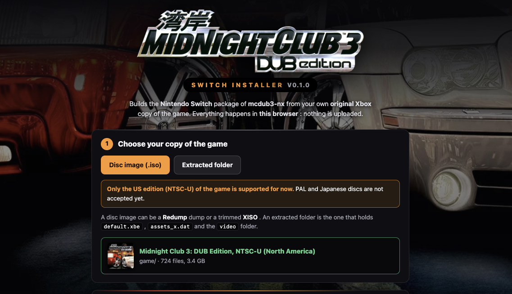

# Midnight Club 3: Dub Edition Installation Page

<p align="center">

A static web page that provides a guided experience to build the Nintendo Switch package of [mcdub3-nx](https://github.com/laureladastra/mcdub3-nx) from the player's own copy of *Midnight Club 3: DUB Edition*. The player picks a disc image (Redump or XISO) or an extracted folder, and the page:

1. reads the disc's file system in the browser (`lib/xdvdfs.js`, a port of the toolkit's `tools/xiso`);
2. checks `default.xbe` the way the game does at boot (size + FNV-1a 64, `lib/xbe.js`) to tell the edition;
3. streams `mcdub3-nx-<edition>.zip` to the downloads folder (`worker.js` + `lib/zip.js`, served by `sw.js`) holding

   ```
   switch/mcdub3-nx/mcdub3-nx-usa.nro         mcdub3-nx-eur.nro for the European disc
   switch/mcdub3-nx/mcdub3_env.example.txt
   switch/mcdub3-nx/game/…                    game-eur/ for the European disc
   ```

   Each NRO looks for its disc in `game-<edition>/` first, then in `game/`, so the editions can share one SD card.

## Run it locally

```sh
scripts/fetch-release.sh        # stages the latest release into release/ and writes release/manifest.json (needs gh, jq)
python3 -m http.server 8000     # then open http://localhost:8000
```

Service workers need `localhost` or HTTPS, so opening `index.html` as a file does not work.

## Deploying

`.github/workflows/pages.yml` publishes the site on GitHub Pages (Settings > Pages > Source: **GitHub Actions**). It
runs on every push to `main`, daily, by hand, and on a `mcdub3-release` repository dispatch. Each run copies the
latest release's NRO into `release/`, because GitHub's release downloads have no CORS headers and the page can't
fetch them itself.

To redeploy right after a release, the game's release workflow can send the dispatch (with a token that can write to
this repository):

```sh
gh api repos/<owner>/<this-repo>/dispatches -f event_type=mcdub3-release
```

## Editions

`release/editions.json` lists every edition the page knows: its `id`, `name`, the `xbe_size` and `xbe_fnv64` of its
`default.xbe` (as in mcdub3-nx's `config/xbe_editions.h`), its NRO and the folder its disc goes in (`game_dir`).
`scripts/fetch-release.sh` writes the `release/manifest.json` the page reads (generated, not committed), marking each
edition `released` when the release has its NRO. The page packages only released editions; a disc of another known
edition is recognised and told its build is not in the release yet. So a new edition becomes installable with the
first release that has its build. The script refuses to deploy a released edition whose hash that release's game
does not accept.

## Artwork

`img/background.jpg` is the source of `img/background.webp`, cropped below the artwork's own logo:

```sh
magick img/background.jpg -crop 1200x655+0+305 +repage png:- | cwebp -q 82 -o img/background.webp -- -
```
